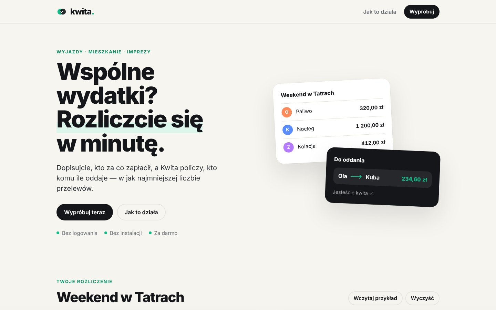
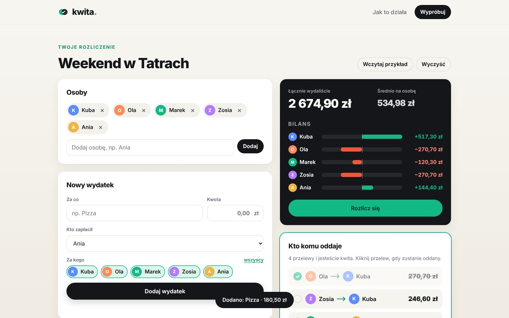

# kwita.

**Rozliczcie wspólne wydatki w minutę.** Aplikacja webowa do dzielenia kosztów wyjazdu, mieszkania albo imprezy: dopisujecie, kto za co zapłacił, a Kwita liczy, kto komu ile oddaje, w jak najmniejszej liczbie przelewów.

> Projekt demonstracyjny. Bez logowania i bez backendu: dane zapisują się tylko w przeglądarce (localStorage).



## Funkcje

- **Osoby:** dodawanie i usuwanie uczestników (osoby z wydatkami są chronione przed usunięciem).
- **Wydatki:** opis, kwota (np. `180,50`), kto zapłacił i **za kogo**, więc wydatek można podzielić tylko na część osób.
- **Bilans na żywo:** suma, średnia na osobę i paski plus/minus dla każdego.
- **„Rozlicz się”:** krótka lista przelewów (algorytm zachłanny, najwyżej *n − 1* przelewów) z odhaczaniem oddanych.
- **Kopiuj podsumowanie na czat:** gotowy tekst do wklejenia na grupę.
- **Przykład „Weekend w Tatrach”** jednym kliknięciem i wersja na telefon.



## Jak to działa

Kwoty są liczone w groszach (liczby całkowite), więc nie ma błędów zaokrągleń. Wydatek dzieli się po równo między zaznaczone osoby; reszta z dzielenia (pojedyncze grosze) trafia do pierwszych osób na liście. Bilans każdej osoby = ile zapłaciła − ile wynosi jej część. Rozliczenie łączy największego dłużnika z największym wierzycielem, aż wszyscy są „kwita”.

## Uruchomienie

To czysty HTML, CSS i JavaScript, bez budowania i bez zależności.

```bash
npx serve
```

…i otwórz `http://localhost:3000`. Możesz też wrzucić folder na dowolny hosting statyczny (np. Cloudflare Pages: framework **None**, build command puste, output directory `/`).

## Technologie

HTML · CSS · vanilla JavaScript · font [Inter](https://rsms.me/inter/) (SIL Open Font License)
